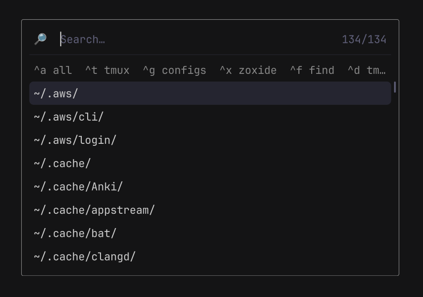

# lm10

a picker menu overlay for wayland (wlroots) based compositors.



## usage

```sh
lm10 --help
```

### configuration

see [examples/lm10.ini](examples/lm10.ini) for default configuration options.
all configuration options are overridable via cli flags.

### examples

see [examples](./examples/) for more usage examples

```sh
# Session menu: lock, log out, suspend and so on.
exec "${LM10:-lm10}" --width 40% <<'ENTRIES'
-n Lock -X loginctl lock-session
-n 'Log out' -X sh -c 'loginctl terminate-session "$XDG_SESSION_ID"'
-n Suspend -X systemctl suspend
-n Hibernate -X systemctl hibernate
-n Reboot -X systemctl reboot
-n 'Reboot into firmware setup' -X systemctl reboot --firmware-setup
-n 'Power off' -X systemctl poweroff
ENTRIES
```

## building

```sh
nix develop
meson setup bld/debug
ninja -C bld/debug
meson test -C bld/debug

# OR
nix build
```

## license

MIT; see [LICENSE](LICENSE). The libraries in `third-party/` keep their own
licenses.
